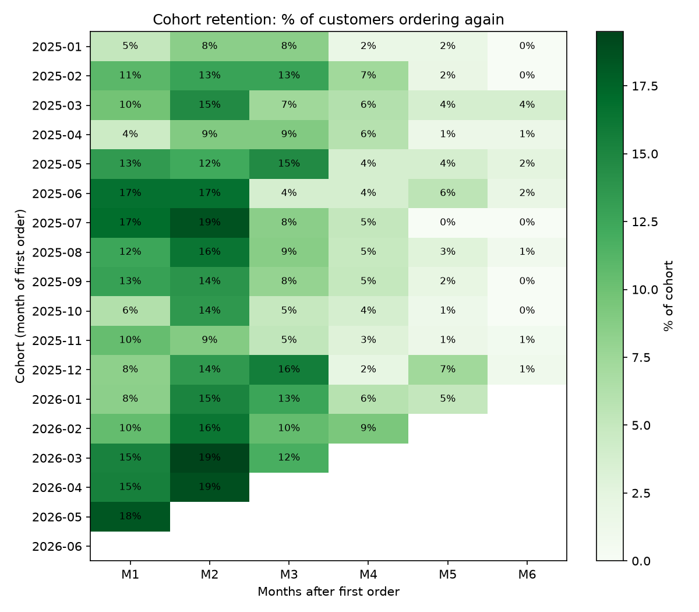

# NovaCart: E-commerce Profitability, Marketing ROI & Customer Retention

**Revenue doubled in 18 months, yet the business made a loss.** This project finds out why, using 18 months of orders, returns and marketing data from an online store in Bangladesh, and recommends what to change.


## Business questions

1. Is NovaCart actually profitable after discounts, returns, product costs, shipping and marketing?
2. Which categories and products really make money?
3. Which marketing channels bring the most valuable customers?
4. Do customers come back? (cohort retention)
5. Was the Black Friday 2025 campaign worth it?
6. What should management do?

## Key findings

| | Finding |
|---|---|
| 💰 **Profitability** | $492K net revenue and $115K gross profit, but $108K went on ads: an **operating loss of $1,960** over 18 months. 10 of 18 months lost money, though the first half of 2026 made +$13.3K. |
| 📦 **Categories** | Electronics brings **60% of revenue at a 12% margin**. Beauty earns 62%. Fashion refunds 22% of sales, half of it for "wrong size". |
| 📣 **Channels** | Facebook Ads take 53% of the ad budget and **lose $42 per customer** after ad cost. Email and Referral customers cost under $40 and earn $43–49 each. |
| 🔁 **Retention** | **72% of customers buy only once.** Those who return do so within 1–2 months. |
| 🏷️ **Black Friday** | Orders doubled, but the 30% discount gave a **−4.7% gross margin**. Its customers came back less than half as often as others. |



## Recommendations

1. **Cut Facebook Ads spend** and move budget to Email and Referral (Facebook lost $26,355 after ad cost).
2. **Never discount below a category's margin.** Cap Electronics at about 10%.
3. **Build repeat purchase** with a follow-up offer 30–45 days after the first order.
4. **Reduce Fashion returns** with size guides (estimated $4,700 saved).
5. **Grow high-margin categories:** Beauty and Home & Kitchen.

Full analysis: [Management report (PDF)](Report/NovaCart_Management_Report.pdf)

## Data cleaning

The raw data had **24 data quality issues** across 6 tables, including duplicate rows, two date formats from a CRM change, 13 spellings of 5 channel names, test accounts, orders dated in the year 2205, and prices and refunds entered 10× too high.

56 of 8,834 rows (0.6%) were removed. Every issue, its row count and the decision taken is documented in the [data quality log](Data/data_quality_log_novacart.xlsx).

## How it was built

| Step | Tool | File |
|---|---|---|
| Profiling and cleaning | SQL (SQLite) | [`SQL/01_data_profiling.sql`](SQL/01_data_profiling.sql), [`SQL/02_data_cleaning.sql`](SQL/02_data_cleaning.sql) |
| Analysis with CTEs and window functions (`LAG`, `RANK`, `ROW_NUMBER`) | SQL | [`SQL/03_analysis.sql`](SQL/03_analysis.sql) |
| Formula model: P&L, product ranking, channels, cohort heatmap, Black Friday scenario | Excel | [`Excel/novacart_analysis.xlsx`](Excel/novacart_analysis.xlsx) |
| Automated pipeline: raw files → cleaning → 5 answers → charts | Python (pandas, matplotlib) | [`Python/novacart_analysis.py`](Python/novacart_analysis.py) |
| Interactive dashboard with date table and time intelligence | Power BI | [`PowerBI/`](PowerBI/) |
| Findings and recommendations | Word / PDF | [`Report/`](Report/) |


## Repository structure

```
Data/
  raw/                          6 original CSV files
  cleaned/                      6 cleaned CSV files
  data_quality_log_novacart.xlsx
SQL/                            profiling, cleaning and analysis queries
Excel/                          formula-driven analysis workbook
Python/
  novacart_analysis.py          end-to-end pipeline
  outputs/                      result tables and charts
PowerBI/                        dashboard (.pbix), PDF export, screenshots
Report/                         management report
novacart.db                     SQLite database (raw + clean tables)
```

## How to reproduce

**SQL:** open `novacart.db` in [DB Browser for SQLite](https://sqlitebrowser.org/) and run `SQL/02_data_cleaning.sql`, then the queries in `SQL/03_analysis.sql`.

**Python:**
```bash
pip install pandas matplotlib
python Python/novacart_analysis.py
```
The script checks that every cleaned table has the expected row count before running the analysis.

## Definitions

- Only **delivered** orders count as sales.
- **Net revenue** = sales after discount − refunds.
- **Gross profit** = net revenue − product cost. Returned items are assumed not resellable.
- **Operating profit** = gross profit − shipping − marketing.
- **CAC** = channel ad spend ÷ customers acquired through that channel.
- **Cohort** = month of a customer's first delivered order.

*The dataset is a practice dataset modelled on a real e-commerce business.*


Muhammad Shafayat Hossain

Linkedin- https://www.linkedin.com/in/shafayat-hossain-305aa5173/
